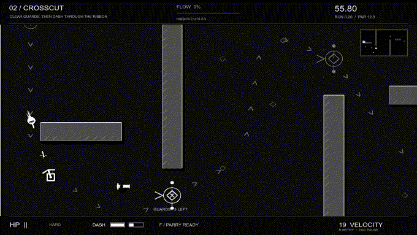

# dash-2 · DASH / FIGHT

**Encuentra la línea. Supera tu límite.**

Un juego de acción cenital para un jugador, construido alrededor de la velocidad, los dashes y la precisión. Seis pruebas compactas te obligan a leer el escenario, devolver proyectiles y encadenar movimientos sin perder el ritmo.

**Windows de 64 bits · Teclado y ratón · Unity 6000.6.7f1 · v0.3.0 / Third Cut · Pre-release**

[**Descargar y jugar**](https://github.com/benjaminramirezangulo-jpg/dash-2/releases/download/v0.3.0/dash-2-Windows.zip) · [Ver la versión publicada](https://github.com/benjaminramirezangulo-jpg/dash-2/releases/tag/v0.3.0) · [Reportar un problema](https://github.com/benjaminramirezangulo-jpg/dash-2/issues)


## Contenido

- [La propuesta](#la-propuesta)
- [Descarga y primeros pasos](#descarga-y-primeros-pasos)
- [Mecánicas y flow](#mecánicas-y-flow)
- [Las seis pruebas](#las-seis-pruebas)
- [Controles y opciones](#controles-y-opciones)
- [Estado, pruebas y próximos pasos](#estado-pruebas-y-próximos-pasos)
- [Desarrollo y estructura](#desarrollo-y-estructura)
- [Créditos y referencias](#créditos-y-referencias)

## La propuesta

Una bufanda blanca atraviesa una sala negra. Las rutas son breves; el reto está en ejecutarlas con precisión. Moverte, disparar y usar el dash forman una misma secuencia: un corte bien colocado puede eliminar una amenaza, recuperar una carga y abrir la siguiente línea de avance.

El proyecto prioriza tres aspectos:

| Pilar | Cómo se refleja en el juego |
| --- | --- |
| **Velocidad** | Movimiento base de 20 unidades por segundo, dashes a 64 y reinicio inmediato del intento. |
| **Control** | Dirección del dash ajustable, movimiento de precisión, parry con ventana corta y colisiones que respetan las paredes. |
| **Lectura** | Blanco, negro y grises; siluetas distintas, señales de ataque y una cámara que acompaña al personaje. |

Está pensado para quien disfruta aprender una ruta, fallar, reconocer el error y volver a intentarlo. La campaña se compone de pruebas cortas que se pueden repetir para mejorar tiempos, rangos y dominio de las mecánicas.

### El juego en movimiento



*Secuencia real de Third Cut a velocidad normal, reproducida desde una grabación de entradas de Crosscut. La controla el verificador automático con movimientos, disparos y dashes normales; no modifica salud ni posiciones. El GIF se presenta a 15 fps y sin sonido; no representa la frecuencia de simulación del juego ni una partida humana.*

### De dónde viene

`dash-2` desarrolla el prototipo educativo [Dash and Fight de hiwhatsup67](https://github.com/hiwhatsup67/dash). Conserva su proyecto de Unity y el reproductor de Windows, e incorpora una campaña de seis pruebas, nuevas reglas de movimiento y combate, menús, ajustes, guardado y herramientas de verificación.

La versión actual se llama **Third Cut**. El nombre del repositorio es `dash-2`; el ejecutable conserva el nombre `DashAndFight.exe`.

## Descarga y primeros pasos

### Jugar en otro PC

1. Descarga [**dash-2-Windows.zip**](https://github.com/benjaminramirezangulo-jpg/dash-2/releases/download/v0.3.0/dash-2-Windows.zip).
2. Extrae **todo** el ZIP en una carpeta.
3. Entra en `dash-2-Windows/` y ejecuta **`DashAndFight.exe`**.
4. Consulta **How to Flow** en el menú de inicio y comienza con **Slipstream**.

Mantén junto al ejecutable las carpetas `DashAndFight_Data`, `MonoBleedingEdge` y los demás archivos distribuidos. **Para jugar no necesitas instalar Unity, compilar el proyecto ni iniciar sesión en un Editor.**

La distribución publicada es para **Windows de 64 bits**. Utiliza teclado y ratón, y su interfaz está en inglés. No se han establecido requisitos mínimos de CPU, GPU o memoria mediante pruebas en distintos equipos; las mediciones de rendimiento disponibles corresponden al equipo de desarrollo.

### Obtener el proyecto completo

Puedes usar **Code > Download ZIP** en este repositorio o descargar [dash-2-project.zip](https://github.com/benjaminramirezangulo-jpg/dash-2/releases/download/v0.3.0/dash-2-project.zip). Después de extraerlo, el juego está en `Executable/DashAndFight.exe` y el proyecto de Unity en la raíz.

Los archivos [SHA256SUMS.txt](https://github.com/benjaminramirezangulo-jpg/dash-2/releases/download/v0.3.0/SHA256SUMS.txt) y las [notas de la versión](https://github.com/benjaminramirezangulo-jpg/dash-2/releases/tag/v0.3.0) permiten identificar los paquetes publicados. Estos ZIP corresponden a v0.3.0; la documentación de la rama `main` puede recibir actualizaciones posteriores.

## Mecánicas y flow

### Movimiento y dash

El movimiento base alcanza **20 unidades/s** y el dash **64 unidades/s**. Cada dash dura **125 ms**, recorre aproximadamente **8 unidades** y admite correcciones de dirección limitadas. Mantener `Shift` reduce la velocidad para realizar ajustes precisos.

Dispones de dos cargas de dash. Eliminar a un enemigo mediante un dash devuelve una carga; las cargas también se recuperan con el tiempo. La elección de la trayectoria influye tanto en la supervivencia como en la posibilidad de continuar atacando.

El modelo funciona con un paso de simulación de **120 Hz** e incluye un búfer de entrada de **120 ms** para el dash. Esto describe las reglas de simulación, no una garantía de 120 fotogramas renderizados por segundo en cualquier equipo.

### Disparo, guardias y parry

Apunta con el ratón y mantén el botón izquierdo para disparar. Algunos enemigos bloquean ataques frontales: debes flanquearlos, aprovechar sus aperturas o devolver sus proyectiles.

`F` activa un **parry** con una ventana de **140 ms**. Los proyectiles cercanos y visibles pueden regresar hacia los enemigos; las paredes bloquean esa interacción. En The Spindle, el fuego devuelto es necesario para romper los escudos de los spinners.

### FLOW y overdrive

Las eliminaciones, los parries y el roce cercano con proyectiles mientras te mueves alimentan **FLOW**. Al alcanzar el umbral de **overdrive**, el movimiento normal sube a **24 unidades/s** y el disparo mejora. El sistema recompensa encadenar acciones y mantener el desplazamiento.

### Fallar, practicar y volver a entrar

- **Hard:** dos puntos de salud.
- **Nightmare:** un punto de salud, con récords separados.
- **`R`:** reinicia el intento.
- **Práctica:** permite trabajar desde puntos de control sin registrar marcas competitivas.
- **Ghosts y tiempos parciales:** ayudan a comparar una ruta con tus mejores intentos guardados.

## Las seis pruebas

Cada prueba tiene una condición de avance y una exigencia adicional de maestría para el rango S.

| Prueba | Objetivo para avanzar | Maestría del rango S |
| --- | --- | --- |
| **01 · Slipstream** | Despejar encuentros y activar sus relés. | Conseguir una cadena de cinco eliminaciones. |
| **02 · Crosscut** | Despejar cada sector y atravesar sus puertas con un dash en la dirección indicada. | Cortar las tres puertas direccionales. |
| **03 · The Spindle** | Devolver disparos para romper escudos y completar los encuentros. | Romper tres escudos mediante fuego devuelto. |
| **04 · Razorwire** | Atravesar las puertas de los láseres con dash; eliminar a todos los enemigos es opcional. | Cruzar dos líneas de láser mientras están activas. |
| **05 · Redline** | Llegar a los puntos de control y escapar de los perseguidores. | Contrarrestar a los tres rushers. |
| **06 · Terminal Velocity** | Completar la ruta y derrotar a un núcleo con tres fases. | Superar las tres fases del núcleo. |


Para obtener **S** también debes terminar sin recibir daño, dentro del tiempo objetivo y con movimiento durante al menos el **78 %** del intento. Los tiempos objetivo son, respectivamente, **8, 12, 18, 12, 12 y 20 segundos**. Superar una prueba desbloquea la siguiente; el rango S es opcional.

**Pendiente de validación:** el buscador automático consiguió registros que cumplen S en cinco pruebas, pero no lo estableció para Redline después de 64 intentos. Eso no demuestra que sea imposible; su exigencia práctica todavía debe revisarse. El resultado está conservado en [mastery-search.csv](TestResults/mastery-search.csv).

## Controles y opciones

| Entrada | Acción |
| --- | --- |
| `W`, `A`, `S`, `D` | Moverse. |
| Ratón | Apuntar. |
| Botón izquierdo mantenido | Disparar. |
| `Espacio` o botón derecho | Dash; el movimiento permite ajustar su dirección. |
| `Shift` izquierdo | Movimiento de precisión. |
| `F` | Parry y devolución de proyectiles cercanos. |
| `R` | Reiniciar el intento. |
| `Esc` | Pausar, continuar o volver. |
| `C` en pausa o tras morir | Acceder a la práctica desde un punto de control. |
| `Tab` | Ampliar el mapa. |
| `Enter` | Continuar, reintentar o avanzar según la pantalla. |

En **Settings** puedes ajustar volumen, música, intensidad de la sacudida de cámara, destellos reducidos, ghosts, asistencia de apuntado y dificultad. El cambio de dificultad se aplica al siguiente intento.

### Progreso y guardado

El progreso de esta versión se guarda en `velocity-v3.json`, dentro del directorio persistente de Unity. En Windows:

```text
%USERPROFILE%\AppData\LocalLow\INACAP\Dash and Fight
```

Los ghosts y las grabaciones se guardan junto a ese archivo. Hard y Nightmare mantienen marcas separadas. El guardado valida sus datos y utiliza sustitución del archivo con copia de respaldo. Los registros de versiones anteriores permanecen separados porque cambiaron las reglas de las pruebas.

## Dirección visual y sonora

El estilo utiliza fondos negros, figuras blancas y grises, trazos de movimiento y algunas tramas. La bufanda y la silueta del personaje ayudan a seguirlo, mientras las formas de los enemigos y las señales de ataque distinguen amenazas sin depender del color.

La referencia al manga se limita al contraste y a los trazos: el diseño mantiene una presentación geométrica sencilla. La intención es que puedas reconocer una abertura mientras te desplazas con rapidez.

El sonido combina efectos sintetizados, una base rítmica y recursos conservados del prototipo. Incluye controles de volumen y música, separación de eventos y un limitador de la mezcla. Las pruebas verifican señal y niveles; la valoración subjetiva de la mezcla sigue pendiente.

## Estado, pruebas y próximos pasos

### Disponible en v0.3.0

- [x] Seis pruebas con rutas y objetivos diferenciados.
- [x] Movimiento rápido, dash dirigido, parry, FLOW y overdrive.
- [x] Enemigos con guardias, persecución y patrones de disparo distintos.
- [x] Núcleo final con tres fases y ventanas de contraataque.
- [x] Menú inicial, guía, pausa y ajustes.
- [x] Guardado, récords por dificultad, rangos y tiempos parciales.
- [x] Puntos de práctica, ghosts y reproducción de entradas.
- [x] Juego portátil de Windows y herramientas de comprobación.

### Evidencia de la versión publicada

Las verificaciones de v0.3.0 se realizaron el **19 de noviembre de 2026**. Los resultados están incluidos en el repositorio; son pruebas del comportamiento del software y no sustituyen una evaluación humana del juego.

| Verificación | Resultado registrado | Evidencia |
| --- | --- | --- |
| Modelo de juego | **95 comprobaciones aprobadas, 0 fallos.** | [model-tests.xml](TestResults/model-tests.xml) |
| Integración en el reproductor real de Unity | **115 comprobaciones aprobadas, 0 fallos.** | [runtime-tests.xml](TestResults/runtime/runtime-tests.xml) |
| Finalización de las pruebas | Las seis tienen grabaciones de entradas ordinarias que llegan a la victoria. | [flow-witness.csv](TestResults/flow-witness.csv) y archivos `stage-*.replay`. |
| Copia portátil distribuida | Volvió a aprobar las 115 comprobaciones de integración. | [Notas de v0.3.0](https://github.com/benjaminramirezangulo-jpg/dash-2/releases/tag/v0.3.0). |

La cobertura incluye velocidad y aceleración, normalización del movimiento, colisiones, puertas direccionales, escudos, láseres, progreso, práctica, guardado, entrada a distintas frecuencias, cámara, interfaz, monocromía, audio y rendimiento con muchos proyectiles.

En la comprobación de la copia portátil se midieron **2.279 fotogramas**, con una media de **4,27 ms**, un percentil 99 de **4,83 ms** y un pico de **67,35 ms**. El ensayo llegó a **376 proyectiles simultáneos**. Las pruebas de percentiles aprobaron, pero hubo un fotograma largo; no se afirma un ritmo de renderizado perfectamente uniforme. El escenario de estrés utiliza invulnerabilidad para sostener la carga; las grabaciones de finalización no la utilizan.

El [informe de la versión](Docs/DASH-2-SNAPSHOT.md), la [rúbrica de calidad](Docs/QUALITY-RUBRIC.md) y la [revisión de Second Cut](Docs/SECOND-CUT-REVIEW.md) conservan el alcance y las limitaciones de las evaluaciones. Third Cut sigue siendo una **pre-release** y no tiene una nueva calificación global validada.

### Prioridades propuestas

| Prioridad | Trabajo pendiente | Qué permitiría comprobar |
| --- | --- | --- |
| Sensación de control | Realizar sesiones humanas con teclado y ratón y recoger observaciones por prueba. | Comodidad, lectura y aprendizaje de las rutas. |
| Maestría | Revisar Redline y su requisito de tres contraataques. | Que S sea exigente y alcanzable con una ruta práctica. |
| Rendimiento | Investigar los fotogramas largos en más equipos y sesiones. | Mayor uniformidad durante el movimiento rápido. |
| Audio | Escuchar y ajustar la mezcla con distintos dispositivos de salida. | Claridad de señales, balance y fatiga auditiva. |
| Compilación | Importar y compilar el proyecto completo en un Editor con licencia activada. | Reproducibilidad del conjunto de recursos y del ejecutable. |

Estas prioridades describen el trabajo por validar. No hay fechas de entrega comprometidas para ellas.

## Desarrollo y estructura

### Abrir el proyecto

```powershell
git clone https://github.com/benjaminramirezangulo-jpg/dash-2.git
cd dash-2
```

Abre la carpeta con **Unity 6000.6.7f1** y utiliza la escena `Assets/Scenes/Game.unity`. El proyecto contiene el comando **Velocity > Build Windows Player**, que genera una distribución en `Builds/Windows/`.

**Alcance de la compilación validada:** el juego distribuido conserva el motor y los recursos serializados del reproductor Mono suministrado. Los scripts se compilan contra sus bibliotecas exactas, y la campaña, las mallas y la interfaz se crean durante la ejecución. La importación y compilación completa de recursos desde el Editor todavía no se han validado en este trabajo por falta de una licencia activada.

### Ejecutar las comprobaciones

Las herramientas usan **Roslyn 4.14.0**. Para ejecutarlas en otro equipo, indica la ubicación de su `csc.exe`:

```powershell
.\Tools\run-all.ps1 -Compiler 'D:\tools\roslyn\tasks\net472\csc.exe'
```

El compilador es una dependencia de desarrollo; no se distribuye como requisito para jugar. Si no se indica `-Compiler`, los scripts utilizan la ubicación original `D:\DashWork\roslyn\tasks\net472\csc.exe`.

La secuencia comprueba el modelo, busca grabaciones que completen las seis pruebas, reconstruye el ensamblado de gameplay y ejecuta la integración en Unity. Los fallos devuelven un código de salida distinto de cero y los informes se escriben en `TestResults/`. El comando recompila y reemplaza el ensamblado de `Executable/`, por lo que conviene ejecutarlo en una copia de desarrollo.

### Reproducir una ruta registrada

Desde la raíz del repositorio:

```powershell
$replay = (Resolve-Path .\TestResults\stage-6.replay).Path
& .\Executable\DashAndFight.exe --dash-replay $replay
```

Estas grabaciones almacenan entradas. No son guiones que coloquen al jugador en la salida o eliminen enemigos mediante cambios de estado. Los escenarios de integración que sí preparan estados de prueba están diferenciados de las grabaciones de finalización.

### Mapa del repositorio

```text
dash-2/
├── Assets/
│   ├── Editor/VelocityBuild.cs       # Compilación desde Unity
│   ├── Scenes/Game.unity            # Escena de arranque
│   ├── StreamingAssets/VelocityAudio/
│   └── scripts/Velocity/            # Reglas, vista, interfaz y persistencia
├── Docs/                           # Informes, rúbrica y material visual
├── Executable/                     # Distribución portátil de Windows
├── Packages/                       # Dependencias de Unity
├── ProjectSettings/                # Configuración del proyecto
├── TestResults/                    # Informes y grabaciones verificables
├── Tests/                          # Regresiones y controlador de verificación
├── Tools/                          # Scripts PowerShell de compilación y pruebas
└── README.md
```

| Archivo | Responsabilidad |
| --- | --- |
| `VelocityModel.cs` | Simulación, colisiones, enemigos, niveles y objetivos. |
| `VelocityGame.cs` | Entrada, menús, HUD, avance y práctica. |
| `VelocityView.cs` | Cámara, mallas, siluetas y efectos visuales. |
| `VelocitySound.cs` y `VelocityAudioCapture.cs` | Síntesis, mezcla y captura opcional del audio del juego. |
| `VelocityRecording.cs` y `VelocityReplayPlayer.cs` | Grabaciones, ghosts y reproducción. |
| `VelocitySave.cs` | Validación y persistencia de progreso y opciones. |
| `VelocityRuntimeTests.cs` | Comprobaciones dentro del reproductor de Unity. |

`GameManager.Awake` inicia esta campaña y desactiva las raíces de la escena anterior. Los componentes originales permanecen como referencia; las reglas actuales están en `Assets/scripts/Velocity/`.

## Reportar problemas y aportar observaciones

Utiliza [Issues](https://github.com/benjaminramirezangulo-jpg/dash-2/issues) e incluye la versión, la prueba, la dificultad, los pasos para reproducir el problema y lo que esperabas que ocurriera. Si afecta al rendimiento, añade tu equipo y resolución. Una grabación o captura ayuda a distinguir un error de una regla poco clara.

Para comentar la sensación del juego, resulta útil indicar el punto concreto: giro del dash, respuesta al soltar una tecla, lectura de un ataque, recuperación tras un error o repetición desde un punto de práctica.

## Créditos y referencias

- **Prototipo de origen:** [hiwhatsup67/dash](https://github.com/hiwhatsup67/dash), Dash and Fight, creado para el trabajo TILE22 de INACAP.
- **Repositorio de esta iteración:** [benjaminramirezangulo-jpg/dash-2](https://github.com/benjaminramirezangulo-jpg/dash-2).
- **Tecnología:** Unity, C# y Roslyn para el flujo de compilación de scripts documentado.
- **Material visual:** capturas del reproductor real de Third Cut y una reproducción de la grabación de Crosscut. El GIF no tiene audio y está reducido para la presentación del README.

La presentación toma como referencia la [guía de Kickstarter para contar un proyecto](https://www.kickstarter.com/help/handbook/your_story?lang=en): explicar la propuesta, mostrar material real, describir lo realizado y exponer los siguientes pasos. También se consultaron las presentaciones de [Hollow Knight](https://www.kickstarter.com/projects/11662585/hollow-knight) y [Crowsworn](https://www.kickstarter.com/projects/mongooserodeo/crowsworn-a-dark-and-mysterious-action-packed-metroidvania) como ejemplos de un concepto breve acompañado de material visual.

Presentación actualizada el **25 de noviembre de 2026**. La versión jugable y las comprobaciones citadas corresponden a **v0.3.0, publicada el 19 de noviembre de 2026**.
